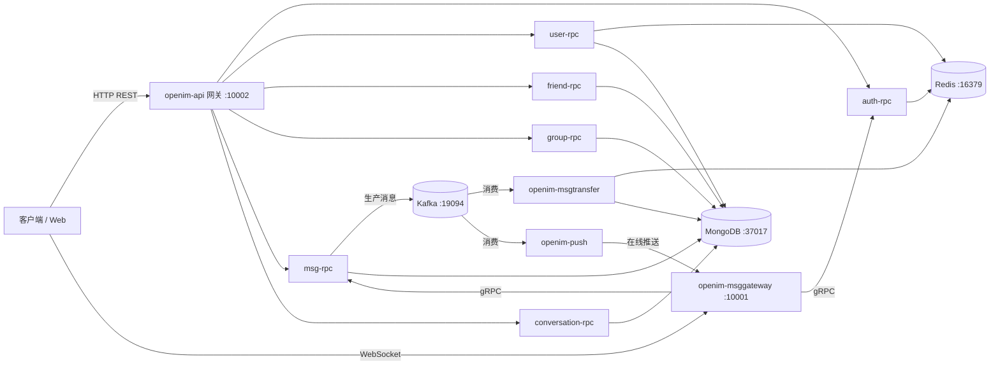

# IM-Server — 即时通讯服务端

基于 Go 的即时通讯（IM）微服务集群。本项目源于开源项目 [OpenIM Server](https://github.com/openimsdk/open-im-server) v3.8，在保留核心架构的基础上进行了企业级模块剥离、代码注释中文化与文档重构，作为个人学习与面试讲述项目。

> 诚实声明：本项目为二次开发学习项目，核心架构来自 OpenIM Server（Apache-2.0），保留 `LICENSE` 文件。

## 架构总览



消息主链路：**客户端 → msg-rpc 落序/落库 → Kafka 解耦 → msgtransfer 分发（在线走 Redis → msggateway → WebSocket 下发；离线走 Mongo）→ push 服务推送**。

## 目录结构

```
├── cmd/                        # 各服务可执行入口
│   ├── openim-api/             #   REST 网关（Gin）
│   ├── openim-msggateway/      #   WebSocket 长连接网关
│   ├── openim-msgtransfer/     #   Kafka 消费：消息分发与落库
│   ├── openim-push/            #   推送服务（在线推送 + 离线推送）
│   └── openim-rpc/             #   六大 gRPC 业务服务 + 第三方能力代理
│       ├── openim-rpc-auth/        #   鉴权（token 签发/校验）
│       ├── openim-rpc-user/        #   用户资料
│       ├── openim-rpc-friend/      #   好友/黑名单
│       ├── openim-rpc-group/       #   群组
│       ├── openim-rpc-msg/         #   消息
│       ├── openim-rpc-conversation/#   会话
│       └── openim-rpc-third/       #   对象存储签名、推送 token、日志代理
├── internal/                   # 各服务业务实现（api/msggateway/msgtransfer/push/rpc）
├── pkg/                        # 基础设施
│   ├── common/storage/         #   ★ 存储分层：Redis 缓存 + MongoDB 持久化 + Kafka
│   ├── common/config/          #   配置加载（YAML + 环境变量覆盖）
│   ├── rpcli / rpccache / localcache/  # RPC 客户端与两级缓存
│   ├── notification/           #   系统通知消息（tip 消息）
│   └── msgprocessor / mqbuild / authverify / callbackstruct / apistruct / dbbuild
├── config/                     # 每个服务一份 YAML + share.yml 公共配置
├── components/                 # docker-compose 挂载数据目录
├── docs/                       # 中文开发文档
├── magefile.go                 # Mage 构建入口
└── docker-compose.yml          # 中间件 + 前端一键启动
```

## 技术栈

| 类别 | 选型 |
| --- | --- |
| 语言 | Go 1.25 |
| RPC | gRPC + Protobuf（`github.com/openimsdk/protocol`） |
| HTTP | Gin |
| 长连接 | WebSocket（自实现连接管理/心跳/多端同步） |
| 消息队列 | Kafka（消息收发与落库/推送解耦，支持 redis/memory 引擎切换） |
| 缓存 | Redis + 进程内本地缓存（localcache） |
| 持久化 | MongoDB |
| 服务发现 | etcd（standalone 模式自动切换为进程内内存注册） |
| 对象存储 | MinIO（可选） |
| 构建 | Mage |

## 快速开始

### 模式 A：源码运行（开发/改造用）

```bash
# 1. 启动中间件（Mongo/Redis/etcd/Kafka/MinIO + 网页前端）
docker compose --env-file .env up -d

# 2. 编译全部服务
mage build

# 3. 启动全部服务（读取 start-config.yml）
mage start
```

启动后访问：

| 地址 | 说明 |
| --- | --- |
| http://localhost:11001 | Web 演示端（注册/登录/聊天） |
| http://localhost:11002 | 管理后台（账号 `chatAdmin` / `chatAdmin`） |

> 注册验证码：短信未配置，直接填 **`666666`**（官方超级验证码）。

### 模式 B：全 Docker（快速演示）

克隆 `openimsdk/openim-docker` 的 `release-v3.8` 分支，`docker compose up -d` 即可跑通全套（含 chat 服务）。该模式使用官方预编译镜像，**对本仓库的源码修改不生效**。

### 常用 Mage 命令

```bash
mage build                      # 编译全部服务
mage build openim-api           # 只编译指定服务
mage start                      # 按 start-config.yml 启动全部
mage stop                       # 停止全部
mage check                      # 检查各服务进程状态
```

## 开发文档

- [配置说明](docs/配置说明.md)
- [开发指南](docs/开发指南.md)
- [Go 代码规范](docs/Go代码规范.md)
- [日志与错误处理](docs/日志与错误处理.md)
- [测试指南](docs/测试指南.md)
- [版本与分支管理](docs/版本与分支管理.md)
- [Kafka 说明](docs/Kafka说明.md)
- [错误码规范](docs/错误码规范.md)
- [命名规范](docs/命名规范.md)

## 许可证

本项目基于 Apache-2.0 许可的 OpenIM Server 二次开发，保留原始 `LICENSE` 文件。仅用于本地学习/私有/非商用。
